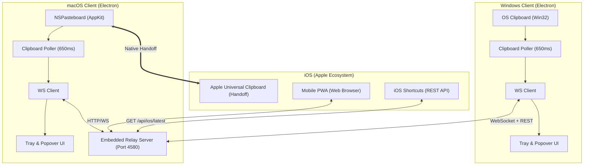

# 🏛️ ClipSync Architecture & Technical Design

ClipSync는 서로 다른 운영체제(Windows, macOS, iOS) 간에 클립보드 데이터를 초저지연(Sub-second)으로 안전하게 실시간 동기화하기 위해 설계된 경량 하이브리드 아키텍처를 채택하고 있습니다.

---

## 1. 시스템 구성도

---

## 2. 핵심 설계 원칙

### 1) 격리된 방 구조 (Sync Key & Room ID)
- 모든 동기화 데이터는 사용자가 지정한 `syncKey`(예: `CS-5N36-2592`)를 통해 암호학적 해시(`SHA-256`)로 생성된 고유 Room ID(`room_<hash>`) 내에서만 격리 처리됩니다.
- 타인이나 다른 팀이 동일한 중계 서버를 공유하더라도 Sync Key가 다르면 데이터가 절대 교차 전송되지 않습니다.

### 2) 순환 동기화 방지 (Sync Loop Prevention)
- 클라이언트가 원격 장치로부터 수신한 클립보드 데이터를 로컬 시스템 클립보드에 쓸 때:
  - `ignoreClipboardUntil = Date.now() + 2000~3000ms`를 설정하여 로컬 클립보드 폴러가 자신이 방금 쓴 내용을 재업로드하지 않도록 방지합니다.
  - 직전 복사 내용의 `SHA-256` 시그니처(`lastClipboardSignature`)를 메모리에 보관하여 내용 변경이 없을 경우 서버 통신을 원천 차단합니다.
  - WebSocket 메시지에 발신 클라이언트 고유 ID(`originClientId`)를 포함하여 본인이 보낸 복사본은 로컬 클립보드에 재적용되지 않습니다.

### 3) 2중 iOS 동기화 브릿지
1. **Apple Universal Clipboard (Handoff) 자동 연계 (Zero-Config)**:
   - Windows에서 텍스트나 이미지를 복사하면 Mac 데스크탑 앱이 수신하여 즉시 Mac의 시스템 `NSPasteboard`에 주입합니다.
   - Apple의 내장 Handoff 메커니즘을 통해 아이폰에서는 별도 앱을 실행할 필요 없이 화면을 길게 눌러 **'붙여넣기'**만 누르면 Windows 복사 내용이 그대로 붙여넣어집니다.
2. **모바일 PWA & 단축어 (LTE / 원격 환경)**:
   - Mac이 없거나 외출 중일 때도 스마트폰 카메라로 QR 코드를 스캔하여 접속 가능한 전용 모바일 웹앱을 내장하고 있습니다.
   - iOS 뒷면 탭이나 동작 버튼에 `GET /api/ios/latest` 단축어를 연동하여 원터치 수신을 지원합니다.

### 4) 인코딩 & 한글 파일명 완전 보존
- macOS(NFD 자모 분리)와 Windows(NFC 완성형 / CP949) 간의 한글 파일명 깨짐을 방지하기 위해:
  - 파일 업로드 시 `fileNameEncoded`(RFC 5987 URI Encoding) 헤더를 병행 전송.
  - 텍스트/CSV 파일 수신 시 CP949 및 BOM 여부를 자동 감지하여 NFC UTF-8로 표준화 변환.

### 5) 서드파티 원격 프로그램 충돌 방지
- TeamViewer 등 원격 제어 도구가 Mac 클립보드에 비정상적인 `/tmp/.CB...` 임시 파일을 기록하는 오작동을 실시간 감지하여, ClipSync의 정상 원본 파일로 자동 복구(`guardAgainstTeamViewerOverwrite`)합니다.
